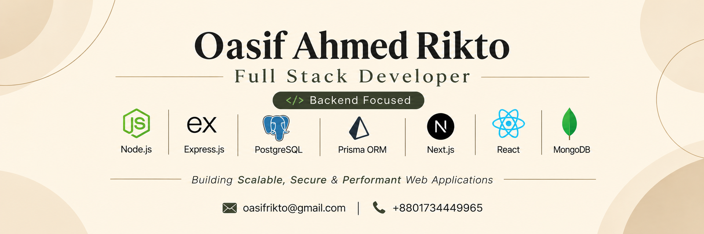

  

<h1 align="center">Hi, I'm Oasif Ahmed Rikto</h1>

  

- 👋 Hi, I'm **@oasif-ahmed**, a passionate **Full Stack Developer**
- 👨‍💻 I'm currently working on **React.js, Next.js, TypeScript and Redux** for frontend development.
- 🔧 Using **Node.js, Express.js, Prisma ORM, MongoDB, PostgreSQL and Redis** for the backend.
- 🐳 I'm currently learning **React Native and Docker**.
- 💬 Ask me about **Full-Stack (React, Next, Node, Express, Prisma, MongoDB, Redis)**.
- 🌐 Explore My Portfolio **[https://oasif-ahmed-rikto-portfolio.vercel.app/](https://oasif-ahmed-rikto-portfolio.vercel.app/)** and My Resume **[Resume](https://drive.google.com/file/d/1u1eJkYcgpB14Nss5f-SOgRH9sSQ3frOy/view)**
- ✍️ I regularly write articles on **[LinkedIn](https://www.linkedin.com/in/oasif-ahmed-rikto-30610b354/)**
- 📫 How to reach me: **[Email](mailto:oasifrikto@gmail.com)**

 

### FOLLOW ME ON SOCIALS:

  
  
  

 

### Tech Stack

  
   
  Node.js

  
   
  Express

  
   
  TypeScript

  
   
  PostgreSQL

  
   
  Prisma

  
   
  Redis

  
   
  Next.js

  
   
  React

  
   
  Tailwind

  
   
  Python

  
   
  Django

  
   
  Docker

  
   
  Nginx

  
   
  AWS

  
   
  Git

  
   
  Postman

  
   
  C++

  
   
  MySQL

